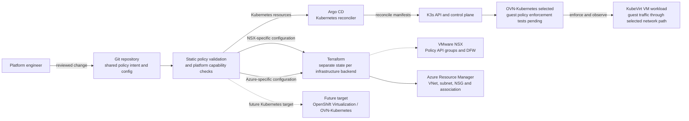

# Architecture

## Status and Intent

This is the target architecture for shared microsegmentation policy intent across VMware NSX, Kubernetes, and Azure VNets/NSGs. The local K3s/OVN-Kubernetes/KubeVirt/CDI infrastructure and Linux guest access are implemented; shared policy adapters, isolation evidence, GitOps delivery, and cloud backends are not complete. OpenShift Virtualization is the preferred longer-term Kubernetes target. See the [checkpoint](IMPLEMENTATION-STATUS.md) for implementation evidence; this is not a command runbook or a production-validated system.

The key design objective is to express workload communication as reviewed, version-controlled policy intent, validate it before deployment, produce platform-specific resources, and test enforcement. The shared definition is not a lowest-common-denominator claim: adapters must identify unsupported or lossy mappings and fail closed rather than silently emit weaker rules.

## System Context

## Components and Responsibilities

| Component | Responsibility | Status |
| --- | --- | --- |
| Git repository | Reviewable source for shared policy intent, platform configuration, and operational documentation | Proposed source of truth |
| Policy validator/adapters | Validate schema, identity references, rule fields, conflicts, capabilities, and platform-specific output | Required; design and implementation pending |
| Argo CD | Reconcile approved Kubernetes manifests into the lab cluster | Proposed; not installed |
| K3s | Lightweight Kubernetes control plane for the initial proof of concept | Installed; pinned configuration checked by task 20 |
| CNI and policy engine | Provide connectivity and enforce supported Kubernetes network policies | OVN-Kubernetes installed; guest allow/deny testing pending |
| KubeVirt | Run test VMs as Kubernetes-managed workloads | Installed; guest launch checks passed; no production sizing claim |
| Terraform | Manage Azure VNet/NSG resources and separately managed NSX resources, each with isolated state | Azure target planned; NSX access/license unavailable |
| OpenShift Virtualization | Longer-term platform against which portability and policy gaps are evaluated | Target direction, not the first lab deployment |

## Policy Model

The shared policy intent should describe workload identity, source, destination, direction, protocol, destination ports, action, and an explicit default-deny posture. Keep intent independent of provider resource syntax; use separate renderers/adapters for NSX, Kubernetes, and Azure.

The Kubernetes proof of concept should use native `NetworkPolicy` resources where they express the intent and an explicit test matrix. The initial policy examples should cover:

- A default-deny baseline for a dedicated test namespace.
- Explicit DNS and management access required for the test workload.
- A named application flow allowed only from a selected source to a selected destination and port.
- Negative tests proving that unlisted ingress and egress flows are denied.

Kubernetes `NetworkPolicy` behavior is additive, and it has no general explicit deny override or global priority ordering. A matching allow from any policy contributes to the allowed set. The CNI must implement NetworkPolicy; merely applying the object proves nothing about packet enforcement. Default-deny ingress and egress are separate, and egress default-deny also requires an explicit DNS allowance when workloads need DNS.

NSX DFW policies use categories, groups, services, and ordered policy/rule constructs. Azure NSGs use ordered first-match rules with priorities 100 through 4096 (lower number is evaluated first) and built-in default rules. Azure defaults allow VNet traffic in both directions and internet outbound, so a default-deny intent needs explicit higher-priority allow exceptions followed by deny rules that override those defaults. Azure NSGs attach to a subnet or network interface, not directly to a VNet; a VNet design must define subnet boundaries and association scope. These models differ, so the adapter must preserve intended outcomes and identify unsupported combinations rather than equating their rule order.

Use a portable baseline for the initial policy contract: L3/L4 allow rules, named identities that each target can resolve, explicit ingress and egress direction, and deny-by-default. Reject conflicting overlapping allow/deny constructs where a target cannot represent the source intent. Record every platform-specific exception and its test evidence. OpenShift administrative policy API availability and behavior must be checked against the selected version.

KubeVirt guests commonly use a pod-backed interface, but the correct binding mode and actual enforcement point depend on the intended network. The original proposal's blanket requirement for masquerade is not accepted as a validated constraint. Test the selected CNI against real guest ingress and egress before fixing the binding mode.

## Platform Boundaries and Mapping

- **Kubernetes:** Reviewed task scripts currently create lab resources. Argo CD is the planned policy owner after bootstrap, not a deployed reconciler. Test pod and KubeVirt guest traffic using OVN; require actual allow/deny tests.
- **VMware NSX:** Terraform and the NSX Policy API provider manage NSX groups/security policies when a supported, licensed manager is available. Provider static validation does not prove NSX realization or enforcement.
- **Azure:** Terraform AzureRM manages VNet address spaces, subnets, NSGs, rules, and subnet/NIC associations. Keep state and deployment scopes explicit. ASGs can provide VM NIC identity within a VNet; CIDRs or other supported constructs may be needed across VNet boundaries.
- **Future Kubernetes target:** OpenShift Virtualization, normally using OVN-Kubernetes. Confirm support for administrative policy APIs and test guest traffic against the target version.

K3s's usual Flannel-based configuration is not the OpenShift OVN-Kubernetes data plane. Because OpenShift fidelity is a project goal, evaluate upstream OVN-Kubernetes as the first CNI candidate for K3s. Verify compatibility with the pinned K3s/Kubernetes and KubeVirt releases before relying on it. If Flannel is used as a fallback, label results as NetworkPolicy and guest-path validation only, not OpenShift dataplane parity. Azure NSGs control VNet traffic and do not replace pod-level policy inside AKS or another Kubernetes cluster.

## Security and Operations Boundaries

- Keep credentials and Terraform state out of Git. Choose secret storage and state handling before enabling any infrastructure apply workflow.
- Do not let Argo CD and Terraform manage the same Kubernetes objects.
- Require a reviewed diff and an explicit plan/apply approval for infrastructure changes.
- Use separate Terraform state, credentials, subscriptions/manager endpoints, and approval gates for Azure and NSX; avoid shared state across providers.
- Require Azure subscription/region budget controls and least-privilege role assignments before any deployment.
- Treat the initial cluster as disposable and isolated; it has no high availability or production security claim.
- Define logging, policy observability, backups, and rollback expectations before calling the lab operationally complete.

## Decisions Still Required

See the [project plan](PROJECT-PLAN.md) for the complete decision register. The local CNI, component pins, storage, and guest binding are selected in task 20. The architecture still needs a policy schema/portability contract, runtime isolation evidence, Azure subscription/scope and network model, test workload acceptance criteria, and an OpenShift comparison.

## Verification Strategy and References

Static validation should check schema types, required fields, unique rule IDs/priorities where applicable, resolvable identities, CIDRs, protocol/port validity, explicit ingress/egress, deny-by-default, and each adapter's capability matrix. Rendered outputs should be validated with Kubernetes schema/CNI-aware checks and `terraform validate`/`terraform plan` against pinned provider versions. A successful static check or plan does not prove realized network enforcement; runtime positive and negative traffic tests remain required.

References checked 2026-10-18:

- [Kubernetes NetworkPolicy](https://kubernetes.io/docs/concepts/services-networking/network-policies/): CNI enforcement prerequisite, additive policies, independent ingress/egress isolation, and default behavior.
- [Azure NSG overview](https://learn.microsoft.com/en-us/azure/virtual-network/network-security-groups-overview): rule ordering, defaults, stateful connections, service tags, and security admin rules.
- [Azure NSG management](https://learn.microsoft.com/en-us/azure/virtual-network/manage-network-security-group): subnet and NIC association and Azure permissions.
- [Terraform AzureRM VNet](https://registry.terraform.io/providers/hashicorp/azurerm/latest/docs/resources/virtual_network), [NSG](https://registry.terraform.io/providers/hashicorp/azurerm/latest/docs/resources/network_security_group), and [subnet association](https://registry.terraform.io/providers/hashicorp/azurerm/latest/docs/resources/subnet_network_security_group_association): provider resources and configuration constraints.
- [Terraform VMware NSX provider](https://registry.terraform.io/providers/vmware/nsxt/latest/docs), [security policy](https://registry.terraform.io/providers/vmware/nsxt/latest/docs/resources/policy_security_policy), and [group](https://registry.terraform.io/providers/vmware/nsxt/latest/docs/resources/policy_group): provider and policy resource models.