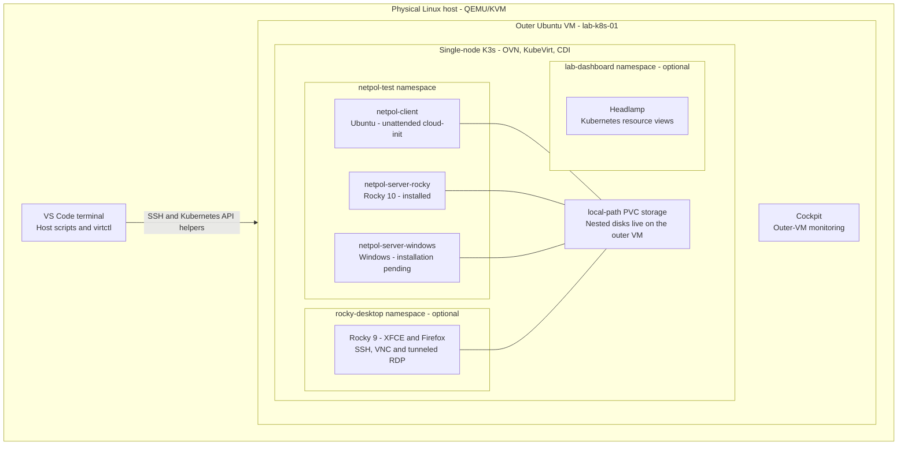

# High-Level Design

This document describes the target design, not a setup sequence. Local infrastructure is implemented; policy adapters, Argo CD, and Azure/NSX deployment remain planned. Use the [checkpoint](IMPLEMENTATION-STATUS.md) and [task guides](../scripts/README.md) for current commands. The long-lived policy plane is now outlined in [microsegmentation-iac](../microsegmentation-iac/README.md).

## Deployment Shape

The first runtime iteration is intentionally small: one QEMU/KVM guest acts as a single-node K3s cluster. KubeVirt runs disposable test VMs on that cluster. A shared, version-controlled policy intent is validated and then rendered to Kubernetes resources, NSX policy resources, and Azure VNet/NSG resources. Argo CD reconciles Kubernetes objects; Terraform manages Azure and NSX infrastructure independently.

This topology is for fast functional learning. It does not provide node failure tolerance, a production-grade control plane, or a validated migration path.

## Deployed Lab Layout

The boxes show where components run, not proof of traffic isolation. Optional services share the same outer VM's capacity. Argo CD and the Azure/NSX backends are planned and are not shown as deployed components.

Use the [checkpoint](IMPLEMENTATION-STATUS.md) for dated runtime state and the [lab setup guide](LAB-SETUP.md) for resource allocations. The desktop is separate from the three-guest policy-test matrix.

## Logical Flow

1. An engineer changes shared policy intent or platform configuration in a branch.
2. Static validation checks intent, identities, rule conflicts, platform capabilities, and rendered artifacts for all requested targets.
3. Review includes Kubernetes manifest checks and separate Terraform plans for Azure and, when available, NSX.
4. An approved change is merged; Argo CD reconciles Kubernetes resources and Terraform applies the separately approved infrastructure plans.
5. Kubernetes is validated with positive and negative tests against pods and KubeVirt guests. Cloud/platform changes require corresponding effective-rule and traffic evidence when credentials/environments are available.
6. Results, unsupported mappings, and any platform-specific deviations are recorded with the policy revision.

## Workload and Policy Layout

Create a dedicated namespace for the test application and label it with stable environment and ownership labels. Use workload labels to distinguish application roles. Keep policy selectors narrow and include an explicit owner and purpose in resource metadata.

The initial policy set should contain a namespace default-deny policy, explicit DNS and required management allowances, and one application allow rule. Egress behavior must be explicitly tested; an ingress-only deny policy does not create a default-deny egress posture. Add only the rules needed by the chosen test workload.

The precise namespace names, labels, CIDRs, ports, and DNS destinations are **TBD** and must reflect the actual lab network. Avoid copying example CIDRs from the source notes into a live configuration without checking for conflicts.

## Policy Delivery and Ownership

| Resource type | Proposed owner | Delivery path |
| --- | --- | --- |
| Cluster bootstrap and K3s configuration | Operator initially; automate after repeatability is demonstrated | Documented setup, then reviewed automation |
| Shared policy intent and platform-neutral metadata | Git | Reviewed change plus schema and capability validation |
| Kubernetes namespace, workload, and network policy | Git | Kubernetes adapter output reconciled by Argo CD after bootstrap |
| VM disk images and KubeVirt VM definitions | Git for definitions; selected storage system for disk data | Argo CD for definitions; storage workflow TBD |
| Azure VNet, subnets, NSGs, rules, and associations | Terraform AzureRM | Separate Azure state, subscription credentials, plan, budget, and approval |
| NSX groups and firewall policy | Terraform NSX provider, when NSX is available | Separate NSX state, credentials, plan, and approval |

Terraform and Argo CD must not concurrently own the same objects. The shared policy contract is required for the three targets, but full parity is not presumed: each adapter must fail on unsupported features or emit a documented exception requiring review.

## Network and Storage Design

**Local network baseline:** the outer VM uses libvirt NAT; nested test VMs use the pod network with masquerade. Host helpers discover the outer address and use SSH/Kubernetes API access. Do not use the nested `10.0.2.2` address as a direct host SSH target. Wider routed/cloud network design remains open. Avoid exposing management interfaces to untrusted networks.

**CNI baseline:** upstream OVN-Kubernetes is installed and its pinned configuration is checked by task 20. Guest traffic enforcement and observable denies still need task 35 evidence. Flannel plus K3s's embedded policy controller is a design fallback, not the deployed configuration. Neither baseline alone proves OpenShift dataplane parity.

**Azure network design (TBD):** define address space, regions, subnet boundaries, peering/routing assumptions, NSG association points, and management ingress. NSGs attach to subnets or NICs, not directly to VNets. Account for Azure's built-in allow rules when implementing deny-by-default and validate effective rules at the NIC.

**Storage baseline:** K3s local-path storage holds nested guest PVCs on the outer VM. This single-node storage does not provide shared-disk migration or HA. Image integrity/import checks are in the task guides; disk growth and backups remain operational responsibilities. Check current host and outer-VM capacity rather than relying on historical snapshots; see [lab setup](LAB-SETUP.md).

## Validation and Completion Criteria

The first usable design is complete when:

- A documented, repeatable procedure builds the single-node cluster and installs KubeVirt.
- The chosen CNI and policy engine are recorded with exact versions.
- A test VM can reach only explicitly permitted destinations and ports.
- Both permitted and denied flows are demonstrated for VM guest traffic, not inferred from pod-only tests.
- A policy change can be reviewed, reconciled, verified, and rolled back through the documented workflow.
- The Azure adapter emits valid VNet/NSG resources and its rule behavior accounts for NSG priorities and built-in defaults.
- The NSX adapter's static output is validated against the selected provider version; runtime realization is verified if a licensed manager is available.
- Resource use, logs, and known limitations are captured.