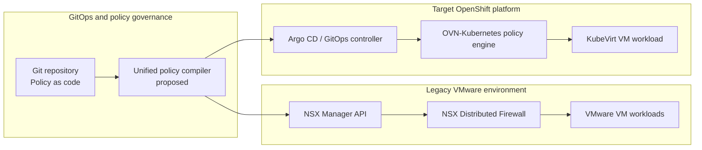

# **VMware NSX to Red Hat OpenShift Microsegmentation Architecture Specification**

> Historical target proposal, not a tested migration specification. Blanket binding requirements, policy API availability, and parity claims below are not accepted as verified constraints. Use the [current architecture](../ARCHITECTURE.md) and [archive notes](README.md).

## **1\. Executive Summary & Strategy**

This document specifies the target architecture, declarative policy translation engine, and phased execution strategy for migrating Virtual Machine (VM) workloads from VMware vSphere/NSX to Red Hat OpenShift Virtualization (KubeVirt). The primary objective is maintaining a zero-trust, default-deny microsegmentation posture across both platforms during transitional co-existence and establishing unified GitOps governance using a vendor-neutral Policy-as-Code schema.

## **2\. Target System Architecture**

## **3\. Core Architectural Components & Mapping**

### **3.1 Policy Abstraction Layer**

To solve the structural mismatch between NSX Distributed Firewall (DFW) rule prioritization and native Kubernetes NetworkPolicy evaluation (additive/unordered), policy generation is driven by an intermediate declarative YAML schema.

| Feature / Abstraction | VMware NSX DFW | Target Red Hat OpenShift / KubeVirt   |
| :---- | :---- | :---- |
| **Workload Identity** | VM Security Tags (Tag / Scope) | Kubernetes Labels (metadata.labels) |
| **Grouping Engine** | nsxt\_policy\_group | Namespace Selectors & Pod Selectors |
| **Network Interface** | vNIC Direct Attach | KubeVirt masquerade binding (Tap interface inside Pod netns) |
| **Policy Engine** | Kernel vNIC Filter (NSX DFW) | OVN-Kubernetes CNI / eBPF / CiliumClusterwideNetworkPolicy |
| **Rule Precedence** | Category Order (Emergency \> Infra \> App \> Catch-All) | AdminNetworkPolicy / ClusterNetworkPolicy priority fields |

### **3.2 Network Binding Constraint**

> * **KubeVirt Binding Mode:** All migrated VirtualMachineInstance (VMI) objects MUST use masquerade interface binding.  
> * **Technical Rationale:** masquerade mode routes guest traffic through an internal bridge and tap device constrained within the KubeVirt Pod's network namespace (netns). This ensures all ingress/egress traffic traverses the OVN-Kubernetes CNI boundary where NetworkPolicy and AdminNetworkPolicy enforcement occurs.

## **4\. Universal Policy Schema & Platform Compiling**

### **4.1 Declarative Source-of-Truth Schema (policy-definition.yaml)**

`schemaVersion: "v1alpha1"`  
`policyName: "payroll-app-isolation"`  
`environment: "production"`  
`defaultAction: "DenyAll"`  
`rules:`  
  `- name: "allow-platform-dns"`  
    `priority: 100`  
    `category: "Infrastructure"`  
    `protocol: "UDP"`  
    `destinationPort: 53`  
    `destinationCIDR: "10.96.0.10/32"`  
    `action: "Allow"`  
  `- name: "allow-web-to-db"`  
    `priority: 300`  
    `category: "Application"`  
    `protocol: "TCP"`  
    `destinationPort: 5432`  
    `source:`  
      `matchLabels:`  
        `tier: "frontend"`  
        `app: "payroll"`  
    `destination:`  
      `matchLabels:`  
        `tier: "database"`  
        `app: "payroll"`  
    `action: "Allow"`

### **4.2 Target Platform Outputs**

#### **1\. VMware NSX Representation (nsx-manifests.tf)**

`resource "nsxt_policy_group" "payroll_frontend" {`  
  `display_name = "grp-payroll-frontend-prod"`  
  `criteria {`  
    `condition {`  
      `key         = "Tag"`  
      `operator    = "EQUALS"`  
      `member_type = "VirtualMachine"`  
      `value       = "tier=frontend"`  
    `}`  
  `}`  
`}`

`resource "nsxt_policy_group" "payroll_database" {`  
  `display_name = "grp-payroll-database-prod"`  
  `criteria {`  
    `condition {`  
      `key         = "Tag"`  
      `operator    = "EQUALS"`  
      `member_type = "VirtualMachine"`  
      `value       = "tier=database"`  
    `}`  
  `}`  
`}`

`resource "nsxt_policy_security_policy" "payroll_app" {`  
  `display_name = "sp-payroll-app-isolation"`  
  `category     = "Application"`  
  `stateful     = true`

  `rule {`  
    `display_name       = "allow-web-to-db"`  
    `source_groups      = [nsxt_policy_group.payroll_frontend.path]`  
    `destination_groups = [nsxt_policy_group.payroll_database.path]`  
    `action             = "ALLOW"`  
    `services           = ["/infra/services/PostgreSQL"]`  
  `}`  
`}`

#### **2\. OpenShift AdminNetworkPolicy Representation (anp-manifests.yaml)**

`apiVersion: policy.networking.k8s.io/v1alpha1`  
`kind: AdminNetworkPolicy`  
`metadata:`  
  `name: payroll-app-isolation`  
`spec:`  
  `priority: 300`  
  `subject:`  
    `namespaces:`  
      `matchLabels:`  
        `environment: production`  
  `ingress:`  
    `- name: allow-web-to-db`  
      `action: Allow`  
      `from:`  
        `- pods:`  
            `namespaceSelector:`  
              `matchLabels:`  
                `environment: production`  
            `podSelector:`  
              `matchLabels:`  
                `tier: frontend`  
                `app: payroll`  
      `ports:`  
        `- portNumber:`  
            `protocol: TCP`  
            `port: 5432`

## **5\. Risk Register & Architectural Mitigations**

> 1. **Rule Precedence Drift:** Standard Kubernetes NetworkPolicy objects cannot enforce explicit drop overrides or rule priorities. Use OpenShift native AdminNetworkPolicy (ANP) and BaselineAdminNetworkPolicy (BANP) APIs to enforce cluster-wide tier precedence matching NSX DFW categories.  
> 2. **Asymmetric Flow During Migration:** Traffic between an unmigrated VMware VM and a migrated OpenShift VM may experience drops. Maintain identical CIDR/Tag-to-Label mappings across NSX Security Groups and OpenShift Namespaces until all dependencies cut over.  
> 3. **KubeVirt Interface Bypass:** Bridge or SR-IOV binding modes bypass pod netns and break CNI enforcement. Enforce policy guardrails (Kyverno/OPA Gatekeeper) blocking KubeVirt VMs without masquerade binding.