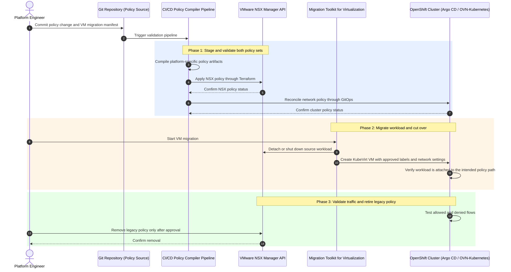
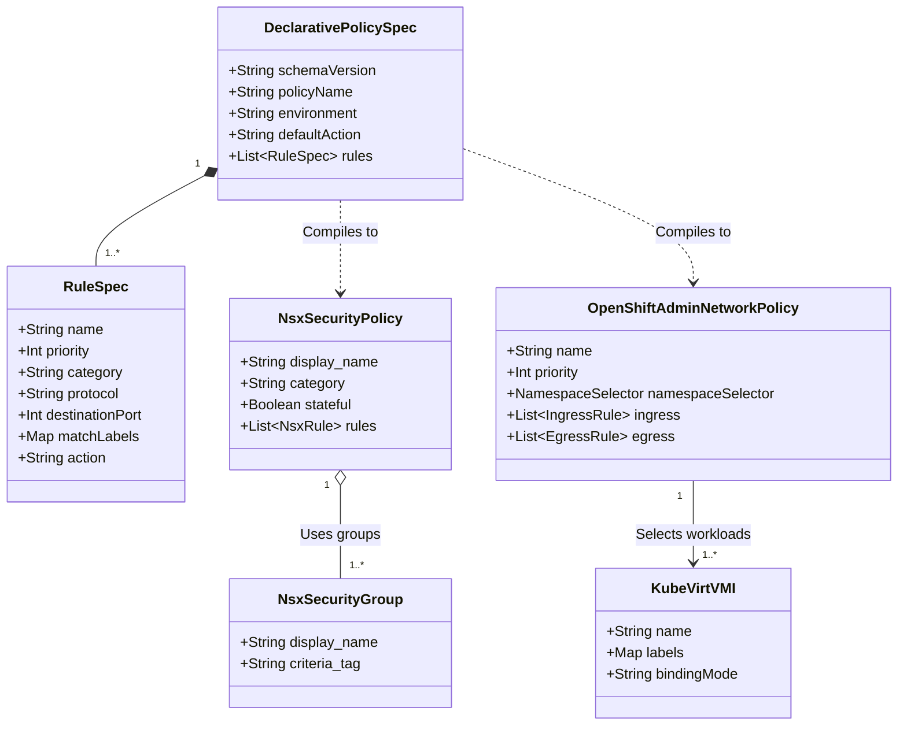

# **VMware NSX to Red Hat OpenShift Microsegmentation Migration Implementation Diagrams**

> Historical diagrams of a proposed migration, not implemented pipelines or current procedures. See the [current design](../HIGH-LEVEL-DESIGN.md), [checkpoint](../IMPLEMENTATION-STATUS.md), and [archive notes](README.md).

## **1\. Implementation Sequence Diagram**

Detailed execution sequence covering dual-policy staging, workload cutover, validation, and legacy decommissioning.  

## **2\. Unified Object & Entity Relationship Diagram**

Mapping of declarative source policy entities to target platform resources across VMware NSX and Red Hat OpenShift.  

