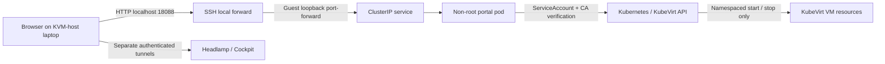

# Lab Switchboard

A small, self-hosted control desk for a K3s / KubeVirt home lab. Launch Headlamp and Cockpit, inspect live guest status, request VM starts or graceful shutdowns, and copy SSH, VNC, and RDP commands for your workstation.

Lab Switchboard runs as a non-root container **inside K3s**. The default deployment is private: a ClusterIP service with an authenticated UI, accessed through an SSH tunnel on the laptop hosting QEMU/KVM. It is an early, single-user lab application, not a production virtualization management platform.

**Paused checkpoint / PC shutdown:** see [STATUS.md](STATUS.md#resume-after-pc-shutdown) for the verified pre-shutdown state, Git status, and ordered restart steps recorded on 2026-10-21. Assume services, guest VMs, and tunnels may be stopped; localhost links require recovery and reopened tunnels after reboot.

## What Is Included

- Live inventory across the configured KubeVirt namespaces, refreshed every ten seconds.
- Per-guest start and graceful stop, with confirmation dialogs and project ownership checks.
- A confirmed **Stop all guests** action; no force shutdown, disk deletion, or automatic reinstall.
- Dashboard launchers with previews of the real lab interfaces.
- Guest-specific SSH, VNC, RDP-tunnel, and RDP-client commands, plus common host operations.
- Password authentication, HttpOnly/SameSite session cookies, CSRF checks, rate limiting, and scoped RBAC.
- Offline simulated mode for development, focused tests, and repeatable container deployment helpers.

The outer QEMU/KVM VM is not a KubeVirt guest. Its start/shutdown commands are listed in the command desk for execution on the physical host. Stopping it also stops this application. There is intentionally no browser shell, privileged host agent, embedded private key, or arbitrary command executor.

## Requirements

For the supplied lab integration:

| Component | Requirement |
| --- | --- |
| Physical host | Linux, QEMU/KVM/libvirt, Bash, SSH, `jq`, `tar`, `git`, `openssl` |
| Outer VM | Project-managed Ubuntu `lab-k8s-01`, key-only SSH and existing automation sudo |
| Cluster | Working K3s + KubeVirt; `netpol-test` and `rocky-desktop` namespaces already exist |
| Image build | Podman installed in the outer VM by the explicit builder-install command below |
| Browser | Modern browser on the physical-host laptop; clipboard access requires a trustworthy origin such as localhost |
| Host guest tools | Existing `work/virtctl-v1.9.1`, kubeconfig, keys/known-hosts; a VNC viewer and FreeRDP for their respective commands |

Standalone host `kubectl`, Helm, Docker, and a container registry are not required by the supplied deployment helper. It imports the image directly into the existing single-node K3s containerd store. Internet access is needed for the initial Ubuntu packages, pinned Node base image, and npm packages.

All integration commands below run from the **parent IaC repository root**, not inside a guest or the project subdirectory.

## Quick Start

Review the plan:

```sh
bash lab-switchboard/scripts/deploy.sh --plan
```

Install the optional image builder in the managed outer VM, then build/import/deploy:

```sh
bash lab-switchboard/scripts/deploy.sh --install-builder
bash lab-switchboard/scripts/deploy.sh --apply
bash lab-switchboard/scripts/deploy.sh --verify
```

This does not start/stop any existing guest VM. It deploys namespace `lab-switchboard`, a Secret and ConfigMap, a single portal replica, a ClusterIP service, and Roles/RoleBindings in the two guest namespaces. Same-named unowned resources are refused. The container has a read-only root filesystem and no added Linux capabilities or host mounts.

Open the portal and leave the terminal running:

```sh
bash lab-switchboard/scripts/access.sh
```

Visit **<http://localhost:18088>**. Open the local, Git-ignored password file `.local/admin-password` privately, and use its contents at the login screen. The file is created on first deployment with mode `0600` inside a mode-`0700` directory; the password is never printed. Do not attach it to chat, commit it, or include it in screenshots. It is separate from Cockpit, Headlamp, and guest credentials.

To make the Headlamp and Cockpit launchers work, leave this second tunnel running too:

```sh
bash scripts/45-monitoring-dashboard/access-dashboards.sh --host
```

| Service | Laptop URL | Authentication |
| --- | --- | --- |
| Lab Switchboard | <http://localhost:18088> | Portal password |
| Headlamp | <http://localhost:18080> | Its own Kubernetes token |
| Cockpit | <https://localhost:19090> | Its own OS account/password; initial certificate is self-signed |

Ctrl+C closes a tunnel and its guest-side port-forward. Restart a helper after a pod replacement, outer-VM restart, or dropped SSH connection. An occupied local port causes a failure rather than forwarding to an unexpected service. The SSH pseudo-terminal and exit traps were chosen to prevent orphan port-forwards.

For a **different laptop**, leave both host helpers running and use authenticated SSH to the physical host:

```sh
ssh -N -o ExitOnForwardFailure=yes \
  -L 127.0.0.1:18088:127.0.0.1:18088 \
  -L 127.0.0.1:18080:127.0.0.1:18080 \
  -L 127.0.0.1:19090:127.0.0.1:19090 user@PHYSICAL_HOST_LAN_IP
```

Do not expose the portal through an unauthenticated ingress, NodePort, or LAN-wide listener. Localhost links refer to the browser's machine, not the container or a nested desktop guest.

## Everyday Use

1. Open the portal and sign in. The VM table shows guest readiness, namespace, and requested CPU/RAM. Readiness is not proof that SSH, RDP, or an installed OS is functioning.
2. Select a guest's play/stop control and review the confirmation. A successful request is asynchronous: wait for the refreshed status. Starting server-test VMs one at a time is recommended; the portal does not enforce a memory budget or guarantee scheduling capacity.
3. Select the guest's access control to view its host commands. Run them in a terminal from the parent repository root. The browser does not execute local programs.
4. Keep an RDP tunnel open in one terminal and run the RDP client in another. Supply passwords directly to the client, not command arguments. Windows RDP requires completed OS installation, enabled RDP, guest firewall allowance, and an exposed TCP 3389 VM port. Commands are not evidence that those prerequisites are ready.
5. Use Headlamp for cluster events/logs and Cockpit for outer-VM OS administration. Their credentials and authorization are independent of the portal.

SSH uses existing host-side keys and strict known-host verification. Guest `10.0.2.2` masquerade addresses are not directly laptop-reachable; the access commands use KubeVirt's API path instead. VNC needs guest graphics and a local viewer. Default configuration offers SSH for the Linux guests, VNC for all guests, and RDP instructions for the desktop and Windows guests. Rocky desktop uses the existing SSH-based `--rdp` helper because xrdp listens only on guest loopback; a direct VMI-to-3389 port-forward would not reach it. The portal does not install or enable these services.

**Stop all guests** sends graceful stops sequentially to eligible running guests. It does not stop the outer VM, wait for every OS shutdown to finish, or force a stuck VMI off. Avoid using it during OS installation or disk maintenance. There is no bulk-start action because the lab's capacity and guest-workflow constraints require deliberate individual starts.

## Configuration

Edit [config/lab.json](config/lab.json), then rerun deployment. The file contains display names, approved namespaces, the project ownership label, dashboard URLs, host key filenames (not private key contents), guest access capabilities, and host command templates.

The supplied Roles are defined explicitly in [k8s/rbac.yaml](k8s/rbac.yaml). If you change namespaces, update and review both configuration and RBAC. The application requires the managed label and `spec.runStrategy: Manual` before sending a lifecycle request. Other guests remain visible but cannot be controlled. Do not change labels or run strategies just to bypass this guard.

| Runtime setting | Default / Purpose |
| --- | --- |
| `SWITCHBOARD_PASSWORD` | Required, at least 24 characters; injected from a Kubernetes Secret |
| `SWITCHBOARD_CONFIG` | JSON configuration path; deployment mounts `/config/lab.json` |
| `BIND_ADDRESS` | `127.0.0.1` locally; `0.0.0.0` inside the container behind ClusterIP |
| `PORT` | `18088` locally; `8080` in the container |
| `COOKIE_SECURE` | Set to `true` only when browser access is HTTPS; localhost SSH-tunneled HTTP uses the default `false` |
| `SWITCHBOARD_DEMO` | Explicitly set `true` for simulated VM state only; never enabled in deployment |

The application reads configuration and credentials at startup. A deployment restart is needed after changes. `--apply` reuses the local password and reconciles configuration; it does not reset the Cockpit/Headlamp accounts. It rebuilds/imports the image and restarts the one replica, so sessions are lost briefly. The fixed local image tag and `imagePullPolicy: Never` are intended only for this single-node lab; for multi-node deployment publish immutable version/digest images to a registry and change the manifest accordingly.

## Password Rotation

With the portal tunnel closed, generate a replacement locally, then redeploy:

```sh
umask 077
openssl rand -base64 32 | tr -d '\n' > lab-switchboard/.local/admin-password
bash lab-switchboard/scripts/deploy.sh --apply
```

This replaces the shared portal password and restarts the server, invalidating existing sessions. Protect the plaintext file and backups; use a password manager for long-term storage. Do not lose the local file and blindly redeploy: a newly generated replacement changes the cluster login. The live smoke test reads this file internally and never outputs it.

## Architecture



The server uses the mounted service-account token with CA-verified HTTPS, re-reading rotated tokens on each API request. It returns a reduced inventory, not full VM definitions/cloud-init. It never mounts the physical host's filesystem, libvirt socket, SSH keys, or admin kubeconfig. Requests and API errors time out rather than hanging indefinitely.

See [SECURITY.md](SECURITY.md) for the authorization boundary and residual risks.

## Development and Tests

From this project directory:

```sh
npm ci
npm test
npm audit --audit-level=moderate
npm run dev
```

Demo mode binds loopback on port 18088 and accepts the deliberately public demo password `switchboard-demo-local-only`. All guest changes are simulated. Use `PORT=18089 npm run dev` if the deployed tunnel occupies 18088. Never expose demo mode outside localhost.

With the real deployment and tunnel running, from the parent root:

```sh
bash lab-switchboard/scripts/deploy.sh --verify
node lab-switchboard/scripts/smoke-test.mjs
```

Unit/integration tests cover action allowlisting, namespace boundaries, ownership/Manual requirements, login/logout, confirmation, CSRF, and local assets. The live smoke test verifies real authenticated inventory and rejection paths without changing VM power state. It intentionally only accepts a loopback `SWITCHBOARD_URL`. Desktop/mobile browser checks should include no horizontal overflow, loaded images/fonts, working filtering, guest access commands, confirmation/cancel, and simulated start/stop.

## Build Outside This Lab

The application and container are self-contained in this folder. On a machine with Podman or Docker, from the project directory:

```sh
podman build -f Containerfile -t lab-switchboard:0.1.0 .
```

The provided integration helpers depend on the **parent repository's** managed-VM SSH helper and work-directory conventions. To publish/use this folder independently, provide your own image distribution and Kubernetes access workflow, ConfigMap/Secret, namespaces, ownership label, and reviewed RBAC. No remote repository or registry image has been published by this task.

## Troubleshooting

| Symptom | Check |
| --- | --- |
| Portal URL refuses connection | Outer VM/cluster running, access helper still active, local port unused |
| Dashboard link refuses connection | Run the separate task 45 dashboard-tunnel helper |
| Inventory unavailable | Both configured namespaces exist, API reachable, portal Roles/RoleBindings intact |
| Start/stop rejected | Ownership label, Manual runStrategy, current VMI state, KubeVirt events; do not force delete disks/VMIs |
| Guest stays Pending | Node capacity, PVC binding, scheduling events; lifecycle request success is not boot success |
| SSH/VNC/RDP fails | Host tool installation, guest readiness/service/firewall/ports, existing keys and known-hosts, NetworkPolicy |
| Repeated login failures | Use the portal password, not Cockpit/Headlamp credentials; wait for rate-limit window after many attempts |
| `ImagePull` / image missing | Reapply to import the image on this node; multi-node clusters need a registry workflow |
| SSH unavailable after a reboot | Use the parent task 20 OVN/network diagnostics; this portal does not repair host networking |

Inspect logs with an administrative Kubernetes client: `kubectl -n lab-switchboard logs deployment/lab-switchboard`. Logs record successful action targets/timestamps but not passwords/tokens. They are operational evidence, not an immutable user audit trail. Shared login means no individual-user attribution.

## Removal

Close the portal tunnel. With an administrative Kubernetes client, first remove RoleBindings/Roles named `lab-switchboard` in `netpol-test` and `rocky-desktop`, then delete namespace `lab-switchboard`. Inspect ownership labels first. These removals do not delete guest VMs or disks. Remove the private local password file when no longer needed. The imported image and Podman build cache remain in the outer VM until explicitly removed; do not prune unrelated images or uninstall shared tooling blindly.

## Project Files

| Path | Responsibility |
| --- | --- |
| [src/server.js](src/server.js) | HTTP authentication, sessions, CSRF, routes, static assets |
| [src/cluster.js](src/cluster.js) | Kubernetes API client, guarded VM lifecycle operations, demo inventory |
| [public/](public/) | Responsive browser interface and local dashboard previews |
| [config/lab.json](config/lab.json) | Lab-specific links, access metadata, commands |
| [k8s/](k8s/) | Restricted Deployment/Service and namespaced RBAC |
| [scripts/](scripts/) | Build/deploy/verify, laptop tunnel, and live smoke test |
| [test/portal.test.js](test/portal.test.js) | Focused automated tests |

Contributions: [CONTRIBUTING.md](CONTRIBUTING.md). License: [MIT](LICENSE). IBM Plex fonts are distributed by Fontsource under their bundled font licenses; Lucide uses the ISC license. Dashboard screenshots depict this repository's lab and are examples, not fixed runtime state.