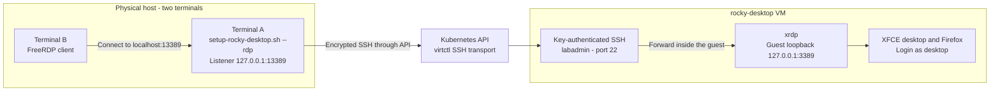

# Unattended Rocky Desktop

This optional desktop is separate from the microsegmentation test guests. It uses its own `rocky-desktop` namespace, VM, disk, SSH key, and known-hosts file. It does not replace or stop the existing Rocky 10 server, Ubuntu client, or Windows VM.

## Configuration

Edit [rocky-desktop.json](rocky-desktop.json) before the first apply. Defaults are Rocky Linux 9, XFCE, Firefox, 4 vCPUs, 6 GiB RAM, a 30 GiB local-path disk, UTC, administrator `labadmin`, and desktop user `desktop`. The image URL and SHA-256 are pinned. Secrets are not stored in JSON; private keys and downloaded images are kept in ignored `work/`.

Rocky 9 was selected with user approval because EPEL 9 publishes XFCE, xrdp, xorgxrdp, and xrdp-selinux; those packages were absent from the checked EPEL 10 repository. Firefox and the official Rocky cloud image were also checked. SELinux remains enforcing. This is a disposable lab, not a supported production desktop platform or a certified performance configuration.

## Provision

Run from the repository root in the physical host's VS Code terminal:

```sh
bash scripts/32-rocky-desktop/setup-rocky-desktop.sh --plan
bash scripts/32-rocky-desktop/setup-rocky-desktop.sh --apply
```

Use `--config path/to/file.json` for a reviewed alternate configuration. Apply checks capacity and project ownership, creates a new disk only, verifies the image checksum, uploads it through CDI, and starts the cloud-init configured VM. No installer interaction or guest password is needed for provisioning. Package installation may take several minutes; success requires cloud-init completion and the final `PASS Rocky desktop, browser, SELinux, and loopback-only RDP services` message, not just a Running VMI.

The administrator uses key-only SSH and unrestricted passwordless sudo for this lab. The separate desktop user has no sudo privileges and initially has a locked password. Do not share the admin private key. Existing PVCs with unexpected ownership, image checksum, or size are refused; an attached OS disk is never reuploaded. Reapply reuses a recognized instance and verifies it; changed first-boot JSON settings do not reconfigure an existing installation automatically.

```sh
bash scripts/32-rocky-desktop/setup-rocky-desktop.sh --verify
bash scripts/32-rocky-desktop/setup-rocky-desktop.sh --ssh
```

SSH stays in your terminal. `exit` disconnects without shutting the VM down. Neither verification nor SSH starts a stopped desktop; start it explicitly when needed:

```sh
export KUBECONFIG="$PWD/work/kubeconfig-lab-k8s-01.yaml"
work/virtctl-v1.9.1 start rocky-desktop -n rocky-desktop
```

Wait for startup before connecting. To stop it gracefully:

```sh
work/virtctl-v1.9.1 stop rocky-desktop -n rocky-desktop
```

## Set Desktop Password

After provisioning, set the non-admin `desktop` user's password once:

```sh
bash scripts/32-rocky-desktop/setup-rocky-desktop.sh --set-desktop-password
```

Type and confirm the password directly in the terminal. Never paste it in chat, JSON, command arguments, or Git. This password is for graphical/RDP login; SSH remains key-only and root SSH remains disabled. Password setup is deliberately separate from unattended provisioning. An account password must be set before RDP or the graphical console can authenticate that user.

## RDP Access

Run both commands below in **physical-host terminals**, not inside Ubuntu/Rocky SSH. If your prompt shows `netpol-client`, run `exit` or open a new VS Code terminal first.

xrdp listens only on the guest's `127.0.0.1:3389`. There is no Kubernetes Service, NodePort, public RDP listener, or direct pod-network RDP forwarding. The script tunnels RDP inside the authenticated SSH connection through the Kubernetes API.



The two loopback addresses refer to different machines: `13389` is on the physical host; `3389` is inside the desktop VM. Keep Terminal A open while using Terminal B. VNC is a separate console path through the Kubernetes API, not part of this RDP tunnel.

Keep this command running in one host terminal:

```sh
bash scripts/32-rocky-desktop/setup-rocky-desktop.sh --rdp
```

Connect an RDP client to `127.0.0.1:13389` using username `desktop` and the password you set. The local port is configurable in JSON. On this host FreeRDP is installed; in another terminal:

```sh
xfreerdp3 /v:127.0.0.1:13389 /u:desktop /dynamic-resolution /clipboard /cert:tofu
```

At `Domain:`, press Enter for the local account. At `Password:`, type the password set for `desktop`; it is not echoed. Use your own visible terminal for these prompts. Do not add `/p:password` to a command or paste credentials into chat. At the xrdp login screen, use the Xorg session.

Keep the first terminal (the SSH tunnel) open. Ctrl+C there closes forwarding without stopping the VM. If connection is refused, check that the desktop is running and the tunnel is still active. RDP and VNC can use separate graphical sessions; log out of one before switching to avoid session conflicts.

Trust-on-first-use records the guest certificate. A localhost connection can report a name mismatch because xrdp's certificate uses `CN=XRDP`; this does not justify ignoring a changed certificate. Compare its SHA-256 fingerprint through the key-verified SSH helper (`--ssh`), then run **inside the desktop VM**:

```sh
sudo openssl x509 -in /etc/xrdp/cert.pem -noout -sha256 -fingerprint -subject
```

Compare that output with the RDP warning before accepting a new identity. Do not disable certificate checks globally or delete remembered certificates just to suppress a warning.

Logging out of XFCE ends the RDP session. FreeRDP may print `ERRINFO_LOGOFF_BY_USER` and exit `12`; this is expected after an intentional logout, not an xrdp service failure. Closing the viewer without logging out may leave the graphical session running. Neither action powers the VM off.

## VNC Console

For the graphical console or recovery:

```sh
bash scripts/32-rocky-desktop/setup-rocky-desktop.sh --vnc
```

The console uses LightDM/XFCE; log in as `desktop`. VNC access is mediated by Kubernetes, not a public VNC server in the guest. SSH remains the normal scripted administration path. VNC and browser/RDP usability need a visual check after provisioning; package presence or a listening port alone does not prove a successful graphical session.

## Recovery

If the outer VM loses SSH due to the known OVN route problem, use task 20's `repair-guest-network.sh --diagnose` and its guarded `--repair` before retrying. Do not rebuild unrelated guests or delete their namespace. This desktop is outside task 30's manual installer creator and task 35's three-guest test matrix. Do not run the creator against it or assume desktop traffic proves isolation.

## Verified Checkpoint

On 2026-10-20, unattended provisioning and an independent verify completed on Rocky 9.8. Cloud-init reported no errors; XFCE, Firefox, xrdp/xorgxrdp, LightDM, SSH, and the guest agent passed their checks with SELinux enforcing. VNC showed the graphical login screen, and Firefox rendered HTTPS as the non-admin user. The user set the password privately and confirmed a working interactive RDP session. Its subsequent intentional logout produced FreeRDP code `12`; xrdp remained active. The presented certificate fingerprint was independently matched through trusted SSH. No existing test guests or disks were changed.

The desktop cloud-init payload uses a managed Kubernetes Secret because it exceeds KubeVirt's inline user-data size limit. That Secret contains the provisioning script and public key, not the private key or a desktop password. The image download supports resuming an interrupted `.part` file, but only a complete SHA-256-verified image is uploaded.