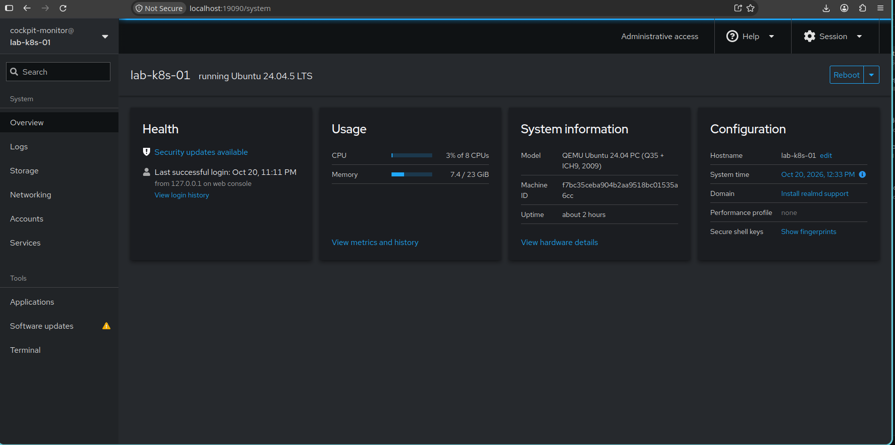
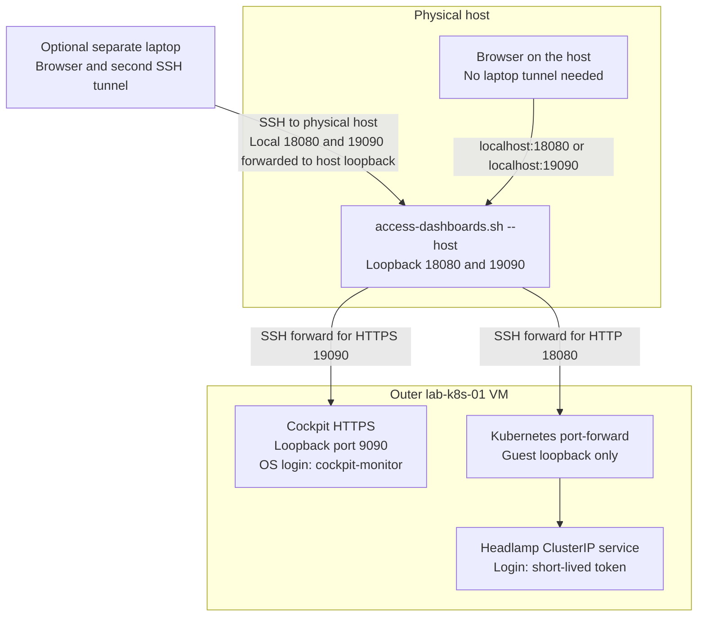
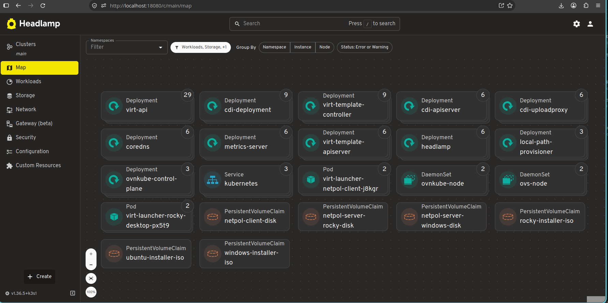

# Lab Monitoring and Dashboards

Return to the [task index](../README.md) or the [monitoring guide](../../doco/MONITORING.md).

These optional tools run alongside task 20. Run setup and permissions scripts on the **physical KVM host**, not inside a KubeVirt guest. They use the existing task 10 SSH key and discover the managed `lab-k8s-01` address through libvirt. They do not change the test VMs or their network policies.

## Choose the Right Step

| Situation | Action |
| --- | --- |
| Dashboards not installed | Preview `setup-dashboards.sh --plan`, then use `--apply` |
| Dashboards already installed | Use `--verify`, then [open the tunnels](#open-the-dashboards); do not reapply just to log in |
| Cockpit password already set | Use it privately; password-generation commands reset it, not retrieve it |
| Password accidentally shared in chat/screenshots | Reset it before reuse; never paste the replacement into chat |
| Headlamp token expired | Generate a new [login token](#headlamp-login-token) |
| Need Kubernetes administration | Explicitly switch RBAC, then restore read-only; this is separate from Cockpit OS sudo |

All script commands below run from the repository root on the physical host unless a block is explicitly labeled for the laptop. A nested desktop browser's `localhost` is not the physical host: it needs an appropriate tunnel of its own.

## Install or Verify

```sh
bash scripts/45-monitoring-dashboard/setup-dashboards.sh --plan
bash scripts/45-monitoring-dashboard/setup-dashboards.sh --apply
bash scripts/45-monitoring-dashboard/setup-dashboards.sh --verify
```

The host needs Bash, `virsh`, `jq`, `ssh`, and `git`. The running Ubuntu VM needs working apt repositories and registry access. Task 20 supplies K3s; standalone host `kubectl` and Helm are not required.

Setup installs Cockpit from the VM's configured Ubuntu apt repositories (the package version follows those repositories), configures its socket to listen only on `127.0.0.1:9090`, and deploys the pinned Headlamp `v0.46.0` image from `ghcr.io/headlamp-k8s/headlamp` into `lab-dashboard`. The Headlamp service is ClusterIP only; no ingress or NodePort is created. Its backend service account has no explicit RBAC grant. The browser authenticates separately with a short-lived service-account token.

Rerunning `--apply` reconciles the deployment and **resets dashboard access to read-only**. It restarts Cockpit's socket/service, briefly disconnecting existing Cockpit sessions, and retains the Cockpit user's existing password. Unowned same-named resources/accounts are refused. An independently installed Cockpit requires manual configuration review instead of automatic adoption.

## Cockpit Login

Setup creates `cockpit-monitor`, initially password-locked, with no sudo membership. It can inspect system resources and read journal/adm logs; those logs can contain sensitive information. Cockpit includes a terminal, so this account also has ordinary OS user access. This is not a restricted kiosk account. Kubernetes permission changes do not affect Cockpit permissions.

Set its password once, **interactively in your own terminal** on the physical host:

```sh
bash scripts/45-monitoring-dashboard/setup-dashboards.sh --set-cockpit-password
```

Alternatively, generate/reset a random password and save it on the physical host:

```sh
bash scripts/45-monitoring-dashboard/setup-dashboards.sh --generate-cockpit-password
```

This resets only the project-managed `cockpit-monitor` account, sends the password over SSH standard input, and saves it to Git-ignored `work/cockpit-monitor-password` with mode `0600` without printing it. Open that file privately to obtain the password. Each run generates a new password, invalidating the previous password for future logins; existing sessions are not revoked. The file is plaintext despite its restrictive permissions: protect host access and backups, or move the credential into a password manager and remove the file. If a reset fails after generating the credential, the script reports a private temporary recovery file instead of discarding it; inspect the failure before assuming which password is active. Interactive password changes do not update the saved file.

Do not put the password in scripts, chat, Git, or command arguments. Use `cockpit-monitor` at the Cockpit login screen. The existing key-only `labadmin` account remains unchanged. Do not enable administrative access in Cockpit or grant this account sudo unless deliberately changing the OS access model.

### Cockpit System Overview

After signing in, select **Overview** to inspect the outer `lab-k8s-01` VM's health, CPU and memory usage, system information, and configuration.



This view monitors the Ubuntu VM hosting K3s, not the physical host or individual KubeVirt guests. Available administrative actions depend on the account's OS permissions.

### Optional OS Administration

To explicitly add the existing project-managed account to Ubuntu's `sudo` group, run on the physical host:

```sh
bash scripts/45-monitoring-dashboard/setup-dashboards.sh --enable-cockpit-sudo
```

This standalone option does not reset the password or change Headlamp RBAC. It checks the managed-account marker and sudoers syntax, preserves other group memberships, and adds no `NOPASSWD` rule. Repeated runs are safe. Log out of Cockpit and back in, then select administrative access and authenticate using the account password when prompted. Existing system sudo policies determine the actual authorization behavior.

This grants OS administration on the K3s host VM, including the ability to obtain cluster-admin credentials regardless of Headlamp's read-only setting. Rotate any password shared in chat before enabling sudo. Normal setup/password-reset commands do not grant this membership, but they also do not remove a previously granted membership. To remove it, run `sudo gpasswd -d cockpit-monitor sudo` inside the outer VM using another administrator; existing sessions retain their groups until ended.

## Open the Dashboards



The diagram shows access paths, not permission grants. Cockpit OS authorization and Headlamp Kubernetes RBAC are independent. A separate laptop needs both tunnels; a browser on the physical host needs only the host helper.

On the physical host, run this and leave the terminal open:

```sh
bash scripts/45-monitoring-dashboard/access-dashboards.sh --host
```

If your browser is on that same machine, open the URLs below directly. If your laptop is a **different machine**, leave the host helper running and run this on the laptop, substituting its normal SSH login for the physical host:

```sh
ssh -N -o ExitOnForwardFailure=yes -o ServerAliveInterval=15 -o ServerAliveCountMax=3 \
  -L 127.0.0.1:18080:127.0.0.1:18080 \
  -L 127.0.0.1:19090:127.0.0.1:19090 paul@PHYSICAL_HOST_LAN_IP
```

If this repository is also available on the laptop, the equivalent helper is:

```sh
bash scripts/45-monitoring-dashboard/access-dashboards.sh --laptop paul@PHYSICAL_HOST_LAN_IP
```

Authenticate to the physical host with your normal SSH key/configuration, not the generated VM SSH key. The physical host needs reachable SSH with local TCP forwarding allowed. Do not bridge the lab VM or open dashboard ports on the firewall just for this workflow.

| Dashboard | Laptop URL | Login |
| --- | --- | --- |
| Headlamp | <http://localhost:18080> | Short-lived token for `dashboard-user` |
| Cockpit | <https://localhost:19090> | `cockpit-monitor` and the password you set |

Cockpit initially uses a self-signed certificate. Check its identity against the guest certificate before accepting the browser warning; do not disable TLS globally. Headlamp's HTTP connection is carried inside SSH between machines. Every tunnel listener binds IPv4 loopback, not a LAN interface. Local users on either machine can still access loopback ports, so authentication remains necessary.

Ctrl+C ends each tunnel. The host helper also stops its guest Kubernetes port-forward. Restart it if the Headlamp pod is replaced, the VM restarts, or the SSH connection drops. If a local port is occupied, the helper fails rather than choosing a different service silently; stop the previous tunnel or use different local ports in a manual SSH command.

## Headlamp Login Token

On the physical host:

```sh
bash scripts/45-monitoring-dashboard/dashboard-permissions.sh token
```

The token is written to the Git-ignored `work/headlamp-token` with mode `0600`, not printed. Read that file privately to paste its contents into Headlamp. If necessary, transfer only this token file to your laptop over authenticated SSH, protect it with mode `0600`, and remove the transferred copy after login. Do not copy the cluster-admin kubeconfig to the browser or commit tokens. Tokens request a one-hour lifetime; the API server controls the actual expiration. Generate another token when it expires. Deleting the local file does not revoke a token already issued.

### Headlamp Cluster Map

After signing in, select the `main` cluster and open **Map** to inspect the cluster's resources. Use the namespace and resource filters to focus the view.



The lab cluster map includes KubeVirt/CDI infrastructure, OVN networking, guest VM launcher pods, and persistent volume claims. Your view varies with the active filters, permissions, and running workloads; the map alone does not verify network-policy enforcement.

## Switch Kubernetes Permissions

```sh
bash scripts/45-monitoring-dashboard/dashboard-permissions.sh status
bash scripts/45-monitoring-dashboard/dashboard-permissions.sh read-only
bash scripts/45-monitoring-dashboard/dashboard-permissions.sh admin --confirm-admin
bash scripts/45-monitoring-dashboard/dashboard-permissions.sh verify
```

Always restore read-only after administrative work:

```sh
bash scripts/45-monitoring-dashboard/dashboard-permissions.sh read-only
```

This updates one dedicated ClusterRole bound to `system:serviceaccount:lab-dashboard:dashboard-user`; it does not change the host's admin kubeconfig. Both switches run effective authorization checks, including denial checks in read-only mode. `status` only reports the configured role annotation; `verify` tests effective permissions and can detect conflicting grants for the tested operations. It is not a complete RBAC audit.

Read-only covers nodes, workloads, pod logs, storage, networking, metrics APIs, KubeVirt/CDI resources, and permission self-checks. It excludes Secrets, pod exec/attach, VM consoles, token creation, and workload mutation. ConfigMaps, logs, and VM specifications (including inline cloud-init) may nevertheless contain sensitive data. Treat read-only tokens as credentials, not public links. Some Headlamp pages show Forbidden when a resource is outside this allowlist.

Admin grants full cluster control, including Secrets, RBAC, VM deletion, and creation of new credentials. This is a shared lab login, not individual user authentication. **All unexpired tokens for this account gain admin access while admin mode is enabled.** Returning to read-only changes subsequent authorization decisions for those tokens, but cannot undo changes, stop already-open privileged streams, or revoke separate credentials created as admin. Admin mode does not auto-expire when the login token expires. For multi-user use, replace this shared account with individual OIDC identities and reviewed RBAC.

## Verify and Troubleshoot

```sh
bash scripts/45-monitoring-dashboard/setup-dashboards.sh --verify
bash scripts/20-install-k3s-kubevirt/check-cluster-status.sh
```

The dashboard verifier checks Cockpit's loopback listener/HTTPS response, Headlamp readiness/ClusterIP service, lack of backend cluster-admin access, and effective browser-account permissions. It does not prove password login or laptop network reachability. Verify those in your browser.

If setup fails partway through, inspect the error and rerun `--apply`; there is no automatic rollback. For SSH/network discovery failures, use [task 20 diagnostics](../20-install-k3s-kubevirt/README.md#check-progress-and-troubleshoot). Do not change OVN or test NetworkPolicies to fix dashboard access without identifying the failure first.

## Removal

Close the tunnels first. With an administrative Kubernetes client, remove `clusterrolebinding/lab-dashboard-access`, `clusterrole/lab-dashboard-access`, and namespace `lab-dashboard`. This revokes the dashboard user's access and removes Headlamp. Inspect ownership labels before deleting anything. Namespace deletion does not uninstall Cockpit.

For Cockpit, log into the outer VM, disable/stop `cockpit.socket` and `cockpit.service`, remove the Cockpit packages only after reviewing apt's proposed removals, and remove this task's socket override/account/marker if no longer needed. Delete token files from the host/laptop. Removing the entire managed lab VM through task 90 also removes these in-VM components.

Sources: [Headlamp in-cluster installation](https://headlamp.dev/docs/latest/installation/in-cluster/), [pinned upstream deployment reference](https://github.com/kubernetes-sigs/headlamp/blob/v0.46.0/kubernetes-headlamp.yaml), and [Cockpit administration guide](https://cockpit-project.org/guide/latest/).