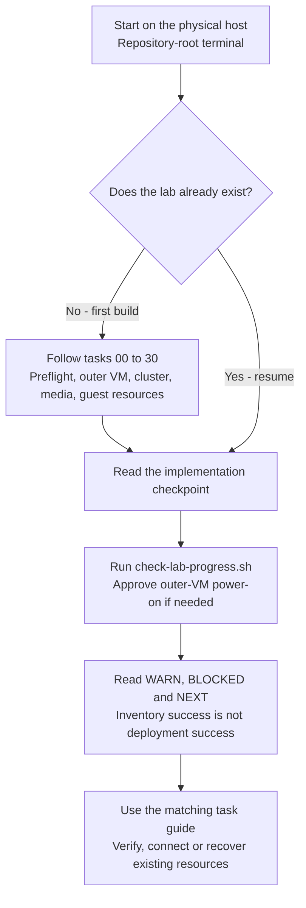

# Lab Setup Tasks

Start from the [project README](../README.md) for project scope and the [lab prerequisites](../doco/LAB-SETUP.md) for host capacity. Each task folder contains its own step-by-step guide and task-specific scripts. The current task 20 bootstrap pins its CNI and component versions; check its guide before changing those pins.

## Command Locations

Unless a block explicitly says otherwise, run it from the repository root on the **physical KVM host**. A prompt such as `labadmin@netpol-client` means you are inside a guest: run `exit` or open a new host terminal first. `work/virtctl-v1.9.1` is the host-side nested-VM client; `sudo k3s kubectl` runs inside the outer VM. A kubeconfig file alone does not install `kubectl`.

Use `--plan` or `--dry-run` before first-time provisioning where supported. Once guests are installed, use their `--verify`/`--ssh` access helpers instead of repeating creation. Ubuntu client and Rocky desktop settings are in JSON beside their setup scripts; the Rocky 10 server's ISO installation and Windows setup are still manual.

RDP and dashboard tunnels need a dedicated terminal left running. Start their client/browser from another terminal on the machine where the loopback tunnel is available. Logging out of SSH or a desktop does not power off the VM.

## Resume After an Interruption

Use the first-build path only for a new lab. Existing installations should enter through the checkpoint and inventory, not repeat the creator.



After a power loss or break, start here:

1. Read the checkpoint in [doco/IMPLEMENTATION-STATUS.md](../doco/IMPLEMENTATION-STATUS.md).
2. Run the progress checker from the repository root; it ends with a single `NEXT:` recommendation after inventory:

   ```sh
   bash scripts/check-lab-progress.sh
   ```

   If the project-managed outer VM is powered off, the checker asks permission to start it (default: no), then waits up to five minutes for networking and SSH before continuing. Declining, unavailable interactive input, or a failed start stops verification with a nonzero exit status. Other non-running VM states require manual attention. Apart from an approved VM start and SSH known-host recording, the checker only inspects state.

3. Follow that recommendation, then update the checkpoint file when a task completes or a new blocker is found.

Common recovery references:

- Outer VM disk too small: [resize the existing VM disk](10-create-lab-vm/README.md#resize-the-existing-vm-disk).
- Outer VM memory sizing: [inspect host/VM RAM and choose a next-boot allocation](10-create-lab-vm/README.md#change-the-vm-memory). This cannot add physical RAM or fix a host-memory shortage by itself.
- No SSH / DHCP lease expired: [task 20 troubleshooting](20-install-k3s-kubevirt/README.md#check-progress-and-troubleshoot) and `repair-guest-network.sh --diagnose`.
- Task 30 VM/PVC/image-pull failures: [task 30 troubleshooting](30-create-kubevirt-vms/README.md#troubleshooting).

## VM Access (SSH and RDP)

**Step 1 — see what is running and which protocols each VM exposes.** The read-only lister shows every nested VM's status, cluster-reachable IP, sizing, labels, the NAT-forwarded `PORTS`, and an `ACCESS` column naming the connection methods (`Running` is green and `Stopped` red in a terminal):

```sh
bash scripts/list-vms.sh                       # all VMs in all namespaces
bash scripts/list-vms.sh --running             # only running instances
bash scripts/list-vms.sh -l app=web            # filter on any VM label
bash scripts/list-vms.sh -l tier=backend,env=test --running
```

Example output (abbreviated):

```text
NAMESPACE      NAME           STATUS   READY  IP           ...  PORTS                 ACCESS
rocky-desktop  rocky-desktop  Running  True   10.244.0.8   ...  22/ssh                ssh (virtctl helper); rdp (ssh tunnel); vnc (console)
seg-db         db-rocky-01    Running  True   10.244.0.56  ...  22/ssh,5432/postgres  ssh (virtctl helper); postgres :5432
seg-web        web-ubuntu-01  Running  True   10.244.0.51  ...  22/ssh,8080/http      ssh (virtctl helper); http :8080
```

`PORTS` is authoritative: only those guest ports are reachable through the NAT, and a forwarded port still needs a service listening inside the guest. A stopped VM must be started before any helper can connect.

**Step 2 — connect with the matching helper.** All guest SSH is key-only (`labadmin`, keys in Git-ignored `work/`) and tunnels through the Kubernetes API via `virtctl`; no guest exposes a public SSH or RDP listener. Run every command from the repository root on the physical host. `exit` leaves a session without powering the VM off.

| VM | Access | Command |
| --- | --- | --- |
| `lab-k8s-01` (outer VM) | SSH | `bash scripts/10-create-lab-vm/login-lab-vm.sh` |
| `netpol-client` (Ubuntu client) | SSH | `bash scripts/30-create-kubevirt-vms/setup-ubuntu-client.sh --ssh` |
| `netpol-server-rocky` (Rocky 10 server) | Scripted SSH checks after install/bootstrap | `bash scripts/30-create-kubevirt-vms/setup-rocky-access.sh --verify` |
| `netpol-server-windows` | SSH after a verified installation | `bash scripts/30-create-kubevirt-vms/setup-windows-server.sh --ssh` |
| `rocky-desktop` | SSH, VNC console, and tunneled RDP (the only VM with a desktop/RDP) | `bash scripts/32-rocky-desktop/setup-rocky-desktop.sh --ssh` / `--vnc` / `--rdp`; see its [quick start](32-rocky-desktop/README.md) |
| Fleet VMs (`web-ubuntu-01`, `db-rocky-01`, ...) | SSH | `bash scripts/34-vm-fleet/setup-vm-fleet.sh --ssh <name>` |

Every other guest besides `rocky-desktop` is a headless server image: no desktop environment, no RDP, no VNC login session. For RDP — including from another machine on your network — follow the [task 32 RDP sections](32-rocky-desktop/README.md#rdp-access).

**Passwords:** SSH never uses one. The desktop's `desktop` user needs a password only for RDP/graphical login (`setup-rocky-desktop.sh --set-desktop-password`). Fleet VMs can optionally get an emergency console password with `setup-vm-fleet.sh --set-password <name>`; this does not enable SSH password login. No password is stored in the repository or recoverable; forgotten passwords are reset the same way they were set.

**Guest IPv4 addressing:** nested VMs use KubeVirt masquerade networking, so *inside* any guest `ip a` always shows the same NAT-internal `10.0.2.2/24` (gateway `10.0.2.1`). That is normal and does not mean IPv4 is broken. The address other workloads reach the VM on is its launcher pod IP (`10.244.0.x`), shown by `sudo k3s kubectl get vmi -A` in the outer VM or `setup-vm-fleet.sh --status`. Use the pod IP for VM-to-VM traffic and policy tests; only ports declared in the VM spec are forwarded through the NAT.

## Task Guides

1. [Host preflight](00-host-preflight/README.md): confirm CPU, memory, disk, nested virtualization, and KVM access.
2. [Create the lab VM](10-create-lab-vm/README.md): provision the single outer Linux guest from the host with the managed libvirt script.
3. [Install K3s, OVN-Kubernetes, and KubeVirt](20-install-k3s-kubevirt/README.md): run the host orchestrator to provision or start the VM, bootstrap the stack, and export kubeconfig.
4. [Prepare guest images](25-prepare-guest-images/README.md): download Ubuntu and Rocky Linux images and stage the Windows Server evaluation ISO.
5. [Create KubeVirt test VMs](30-create-kubevirt-vms/README.md): create/boot-check guests, then use [JSON-configured unattended Ubuntu setup](30-create-kubevirt-vms/README.md#unattended-ubuntu-setup); Rocky and Windows have separate installation procedures.
6. [VM fleet](34-vm-fleet/README.md): declare additional scalable test VMs in a single `fleet.json`, built from approved Ubuntu/Rocky blueprints with per-app namespaces and microsegmentation labels.
7. [Verify Kubernetes isolation](35-verify-kubernetes-isolation/README.md): test allowed and denied flows across the configured Linux and Windows guests.
8. [Azure and NSX static checks](40-validate-infrastructure-targets/README.md): validate generated infrastructure plans without requiring both platforms to be available.
9. [Clean up the lab](90-cleanup/README.md): preview or remove the managed lab VM and generated state with `cleanup-lab.sh` before restarting from task 10.

Optional: [Monitoring and dashboards](45-monitoring-dashboard/README.md) adds Cockpit, Headlamp, laptop SSH tunnels, and a verified read-only/admin permission toggle. See the [monitoring inventory](../doco/MONITORING.md) for all lab monitoring tools.

The K3s/OVN-Kubernetes/KubeVirt lab has passed component-health and guest-boot checks. It is a single-node proof of concept, not a production topology; network-policy enforcement and OpenShift equivalence are not yet demonstrated. Keep all guest data disposable until backup and recovery procedures are defined.

## Shared Library

Common plumbing lives in [lib/common.sh](lib/common.sh) and is sourced by the task scripts: required-command checks, managed-outer-VM guards, outer-IP discovery, `remote kubectl`, `virtctl ssh` wrappers with pinned per-guest known-hosts files, heartbeat SSH wait loops, checksum-verified image fetching, and CDI upload tunnels. New scripts must use these `msl_*` helpers instead of re-implementing them. The dashboard tasks additionally share [45-monitoring-dashboard/common.sh](45-monitoring-dashboard/common.sh) for dashboard-specific access.

## Rocky Desktop

[Unattended Rocky desktop](32-rocky-desktop/README.md): JSON-configured separate Rocky 9/XFCE/Firefox VM with key-based SSH, a VNC console, and localhost-only tunneled RDP. It is not part of the three-guest isolation-test matrix and does not replace the existing Rocky server. Check capacity before running it alongside test workloads.